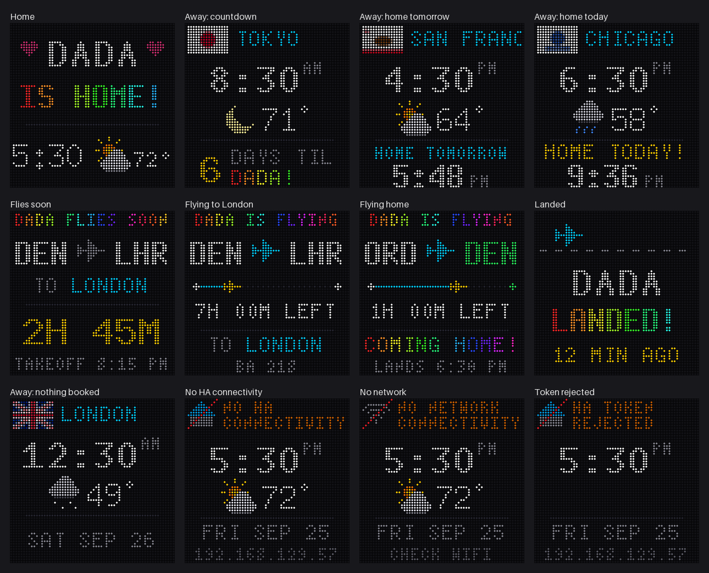

# FlightWall: "Where's Dada?"

A 64×64 LED matrix display for the kids that shows where Dada is. It shows the city he's in, the time and weather there, a live progress bar when he's in the air, and a countdown to when he's home. It's inspired by [TheFlightWall](https://theflightwall.com), but runs on a Raspberry Pi and pulls everything from Home Assistant.



*Rendered previews of every screen. The flags here are rough stand-ins; the Pi downloads real flag images.*

## What it shows

The screen is picked automatically, in this order:

| Screen | When | Shows |
|---|---|---|
| **Flying** | A flight from the calendar is in progress | "DADA IS FLYING", route (ORD → DEN), progress bar with a moving plane, time left. Flights home add "COMING HOME!" and the landing time; others show "TO LONDON" and the flight number. |
| **Landed** | A flight into Denver landed less than 90 min ago | "DADA LANDED! 12 MIN AGO" |
| **Flies soon** | Any booked flight takes off within 4 hours, from any airport, even if his phone says he's home | Route, "TO LONDON" (or "COMING HOME!"), countdown ("2H 45M", then "40 MIN") and takeoff time |
| **Offline** | Home Assistant or the network has been unreachable for 90 s | Denver time, weather and date, plus what's wrong (see [Troubleshooting](#troubleshooting)) |
| **Home** | Phone is within 40 km of Denver | "DADA IS HOME!" with Denver time and weather |
| **Away** | Anywhere else | State flag (US) or country flag, city name, local time, weather, and a countdown to the next flight home: "6 DAYS TIL DADA!", then "HOME TOMORROW" / "HOME TODAY!" with the arrival time |

The flight screens use the last calendar the app read, so they keep working even if Home Assistant goes down mid-trip. A small blinking orange dot in the top-right corner means something is partly down (for example, the internet is down but HA is fine) without needing the full offline screen.

The panel dims from 8:30 pm to 6:30 am Denver time.

## Hardware

| Part | Notes |
|---|---|
| Raspberry Pi 4 | The Pi 5 isn't supported by the LED library |
| Waveshare RGB-Matrix-P3-64x64 | 64×64 HUB75 panel, 3 mm pitch, 192×192 mm. Comes with ribbon and power cables. |
| WatangTech / SEENGREAT RGB Matrix Adapter Board | HUB75 adapter for the Pi's 40-pin header. Uses the library's default `regular` pin mapping, with the 64×64 **E** line on GPIO 15. |
| 5V 4A power supply, **5.5×2.1 mm** barrel | Center-positive, UL/ETL listed. Powers the panel and the Pi together. |
| microSD card, 16–32 GB | |

No soldering is needed.

### Wiring

1. Press the adapter board onto the Pi's 40-pin header, with the 3V3/5V end at the Pi's pin-1 corner (away from the USB/Ethernet ports).
2. Plug the grey ribbon into the adapter's HUB75 socket and into the panel's **input** header. That's the left header on the upper circuit board, labeled HUB75, with the arrow pointing right. The right header is for chaining a second panel.
3. Connect the red/black power lead from the adapter's VH-4P output to the panel's VCC/VCC/GND/GND header.
4. Set the adapter's **RPI PWR** jumper to **ON**, then plug the supply into the adapter's DC jack.

**Only use one power supply.** Don't also plug USB-C into the Pi: two supplies feeding the same 5V rail can damage things.

## Data sources

| What | From |
|---|---|
| Where Dada is | Home Assistant person entity (iPhone companion app GPS) |
| City, state/country | [OpenStreetMap Nominatim](https://nominatim.org) reverse geocoding, cached |
| Flights | Home Assistant calendar fed by Flighty's Calendar Export |
| Weather and local time zone | [Open-Meteo](https://open-meteo.com) (free, no key) |
| Flags | [flagcdn.com](https://flagcdn.com): US state flags (`us-co`) and country flags (`jp`), cached |
| Airport → city names | [OurAirports](https://ourairports.com/data/), downloaded once and cached |

### Getting Flighty flights into Home Assistant

1. In Flighty, turn on **Calendar Export** and send it to a calendar (Google or iCloud).
2. Add that calendar to Home Assistant (Google Calendar or CalDAV integration). Note its entity ID, e.g. `calendar.flighty`.

The parser reads Flighty's event format, e.g. `✈ ORD→DEN • UA 2211`, including the zero-width and non-breaking spaces Flighty inserts. Events titled like "Flight to Denver" also count. Event start = departure, end = arrival.

## Install

### 1. Raspberry Pi OS

Flash **Raspberry Pi OS Lite (64-bit)** with Raspberry Pi Imager. In its settings, set the hostname, username, WiFi, and enable SSH.

### 2. System setup and LED library

SSH in and run this once. The `isolcpus` line appends to a file, so don't run the block twice.

```bash
sudo apt update && sudo apt full-upgrade -y
sudo apt install -y git build-essential python3-dev python-dev-is-python3 python3-pil python3-requests cython3
sudo sed -i 's/^dtparam=audio=on/dtparam=audio=off/' /boot/firmware/config.txt
echo "blacklist snd_bcm2835" | sudo tee /etc/modprobe.d/blacklist-rgb-matrix.conf
sudo sed -i '1 s/$/ isolcpus=3/' /boot/firmware/cmdline.txt
git clone https://github.com/hzeller/rpi-rgb-led-matrix
make -C rpi-rgb-led-matrix/examples-api-use
cd rpi-rgb-led-matrix && sudo pip3 install . --break-system-packages && cd ~
sudo reboot
```

Test the panel. You should see a spinning square filling the whole panel:

```bash
sudo rpi-rgb-led-matrix/examples-api-use/demo -D0 --led-rows=64 --led-cols=64 --led-slowdown-gpio=4
```

### 3. FlightWall

```bash
git clone https://github.com/YOUR_USER/flightwall.git ~/flightwall
cd ~/flightwall
cp config.example.json config.json
nano config.json            # HA URL, token, entity IDs
python3 wall.py --check     # step-by-step connectivity check
sudo python3 wall.py --demo # cycle through every screen with fake data
```

### 4. Start on boot

```bash
sudo cp flightwall.service /etc/systemd/system/
sudo systemctl enable --now flightwall
```

To apply changes after editing, run `sudo systemctl restart flightwall`. To see logs, run `journalctl -u flightwall -f`.

## Configuration

`config.json` holds your Home Assistant token and is git-ignored. Anything you leave out uses the default.

| Key | Default | What it does |
|---|---|---|
| `ha_url` | | Home Assistant URL. Use the IP (`http://192.168.1.3:8123`); the Pi often can't resolve `homeassistant.local`. |
| `ha_token` | | Long-lived access token (HA → your profile → Security) |
| `person_entity` | `person.maxwell` | Person whose GPS location is tracked |
| `flight_calendar` | `calendar.flighty` | Calendar with the flights |
| `home` | Denver | `lat`, `lon`, `radius_km` (counts as home), `airports` (flights to these are "home"), `tz` |
| `dad_name` | `DADA` | Name shown on screen |
| `leaving_soon_hours` | `4` | Hours before any booked flight that the "flies soon" screen starts (decimals OK, e.g. `2.5`; up to 168) |
| `landed_minutes` | `90` | Minutes after landing in Denver that the "landed" screen stays up |
| `lookahead_days` | `90` | How far ahead to read the calendar; a flight home further out than this shows the date instead of a countdown |
| `offline_after_s` | `90` | Seconds of failure before the offline screen appears |
| `airport_names` | `{}` | Override city names, e.g. `{"XNA": "Bentonville"}` |
| `place_names` | `{}` | Override city names from the map lookup, e.g. `{"City of Westminster": "London"}`. A leading "Greater " is dropped automatically ("Greater London" → "London"). |
| `temp_unit` | `fahrenheit` | Or `celsius` |
| `clock_24h` | `false` | `true` shows 17:30 instead of 5:30 PM |
| `location_every_s` / `calendar_every_s` / `weather_every_s` | `60` / `300` / `600` | How often to poll HA location, the flight calendar, and weather |
| `brightness` / `night_brightness` | `60` / `15` | 0–100 |
| `night_start` / `night_end` | `20:30` / `06:30` | Dimming window, Denver time |
| `rotate` | `0` | `90` / `180` / `270`, clockwise, if the panel is mounted sideways or upside down |
| `gpio_slowdown` | `4` | Lower (2–3) refreshes faster; raise it if you see sparkle or ghosting |
| `web_password` | `""` | Password for the settings page. The page is off until you set this. |
| `web_port` | `8080` | Port for the settings page |
| `visitor` | off | Temporary visitor screen; easiest to set on the settings page (see below) |
| `font_dir` | `/home/mk/rpi-rgb-led-matrix/fonts` | BDF fonts from the LED library |
| `all_events_are_flights` | `false` | Treat every calendar event as a flight |

## Settings page

Set `web_password` in `config.json` and restart. Then open `http://<pi-ip>:8080/` (any username, that password). It shows a live preview of the panel, what the display currently knows (location, HA status, upcoming flights), and every setting in the table above.

Most changes apply as soon as you press **Save**. Changing `gpio_slowdown`, the home time zone or the port restarts the display automatically. Saving rewrites `config.json`: other keys are kept, and the file keeps its owner and is set to mode 600, since it holds the HA token. The token and password are never sent to the browser; leave those boxes blank to keep them.

It's plain HTTP with Basic auth, so keep it on your LAN (no port forward). Use your VPN to reach it from outside.

## Visitor (temporary override)

For Grandma's trip, say. In the settings page's **Visitor** section, tick **Show a visitor** and fill in their name, where they are (or leave it blank to use the departure airport's city), the flight number, the from/to airports, and departure and landing times in **local airport time**, as printed on the ticket (departure in the departure airport's time zone, landing in the arrival airport's). The time zones are looked up from the airports when you save; a landing before takeoff or a flight over 22 hours is rejected as a likely date mistake. Then:

1. **Until their flight**, the screen shows them instead of the home/away screen: flag and "CHICAGO", local time and weather, and a countdown ("3 DAYS TIL GRAMMY!", then "HERE TOMORROW" / "HERE TODAY!" with the landing time).
2. **During the flight**: "GRAMMY IS FLYING", progress bar, "ON THE WAY!".
3. **After landing**: "GRAMMY LANDED!" for `landed_minutes`.
4. Then everything goes back to normal by itself. You can untick the box afterwards (the status says when it's finished).

Dada's own flights always come first: if one of his flights is about to leave, in the air, or just landed, that screen shows instead.

## Commands

| Command | What it does |
|---|---|
| `sudo python3 wall.py` | Normal mode (what the service runs) |
| `python3 wall.py --check` | Tests network → HA → token → entities → flights → weather, and prints a fix for anything that fails. Lists your HA's person and calendar entities if the configured ones aren't found. |
| `sudo python3 wall.py --demo` | Cycles every screen with made-up data, 8 s each. Stop the service first. |
| `python3 wall.py --png DIR` | Renders the demo screens to PNG files, no panel needed |

## Troubleshooting

**Panel**

| Symptom | Fix |
|---|---|
| Two blue lines, nothing else | Normal: the panel is powered but nothing is sending data yet |
| Completely dark | Ribbon in the panel's output header instead of input; check power lead |
| Only the top half is right | The E address line isn't reaching the panel |
| Sparkle, ghosting, garbage | Raise `gpio_slowdown` |
| Flicker | Make sure onboard audio is off and `isolcpus=3` is in `cmdline.txt` |

**Offline screen messages**

| Message | Meaning | Bottom line |
|---|---|---|
| NO NETWORK CONNECTIVITY | Pi has no network (WiFi down) | CHECK WIFI |
| NO INTERNET CONNECTIVITY | Local network works, internet doesn't, and HA is unreachable | HA DOWN TOO |
| NO HA CONNECTIVITY | Network is fine, Home Assistant isn't answering | Pi's IP, for SSH |
| HA TOKEN REJECTED | Token is wrong or was deleted | Pi's IP |
| HA PERSON NOT FOUND | `person_entity` doesn't exist | Pi's IP |

**Testing the HA connection by hand**

```bash
nc -zv -w 5 192.168.1.3 8123                          # is the port reachable?
curl -v --max-time 5 http://192.168.1.3:8123/api/     # 401 = reachable, wants a token
curl -H "Authorization: Bearer YOUR_TOKEN" http://192.168.1.3:8123/api/   # {"message":"API running."}
```

A **timeout** means the network is dropping the traffic. The usual cause is the Pi being on a different subnet or VLAN from HA (an IoT or guest network, or behind a travel router), with a firewall blocking the path. Put the Pi on HA's network, or allow the Pi's source address to reach HA on TCP 8123. Behind a VPN or travel router, HA sees the router's VPN address, not the Pi's.

## Credits

- [hzeller/rpi-rgb-led-matrix](https://github.com/hzeller/rpi-rgb-led-matrix): the LED matrix driver and fonts
- [TheFlightWall](https://theflightwall.com): the inspiration
- Data from OpenStreetMap, Open-Meteo, flagcdn, and OurAirports
